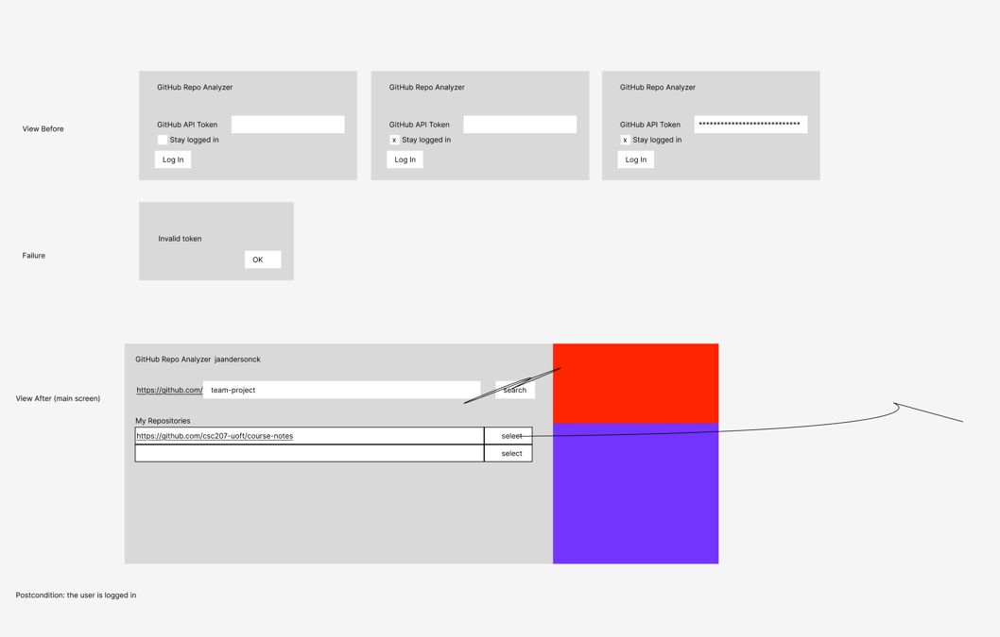
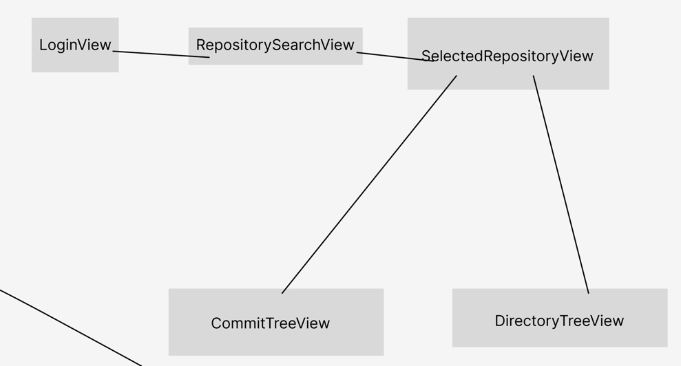
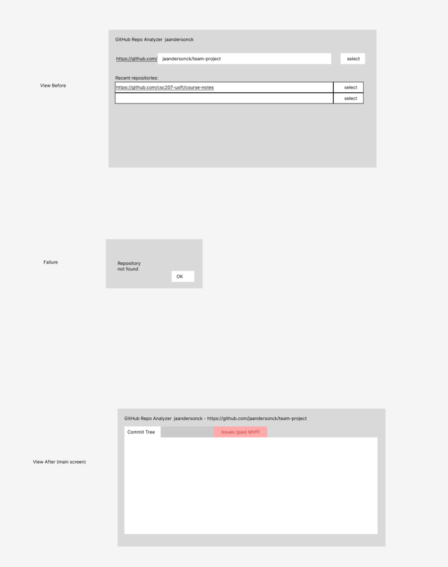

## Team Information  
### Team Members  
- Jack Anderson  
- Jason Luo  
- Taha Tahir  
- Yusuke Ichiba  
---  
## Project Description  
GitHub repo analyzer allows members across a software development team to quickly visualize important metrics about project repositories.
---  
## User Stories
### User Story 1
*As a developer on a software team, I want to sign in with my GitHub personal access token so that the app can read the repositories (including private ones) that I have access to.*
- **Use case:** UC1
- **Acceptance criteria:**
	- A valid token takes me to repository selection and shows my GitHub username.
	- An empty, invalid, or expired token shows a clear error and nothing is saved.
	- If I tick "remember me", the next launch skips the login screen.

### User Story 2
*As a developer who works on several projects, I want to choose one of my repositories from a list (or type `owner/name`) so that I don't have to look up its exact name every time.*
- **Use case:** UC2
- **Acceptance criteria:**
	- The list shows every repository my token can see.
	- Choosing a repository opens its dashboard (ownership, commit graph, pull requests).
	- A repository that doesn't exist or that I can't access shows "Repository not found".

### User Story 3
*As a new contributor, I want to see who has contributed most to each directory so that I know who to ask about, or request a review from, for that part of the code.*
- **Use case:** UC3
- **Acceptance criteria:**
	- The repository is shown as an expandable directory tree.
	- Each directory shows its top contributor and that contributor's share of commits.
	- Directories with no commit history are labelled "no owner".

### User Story 4
*As a team lead, I want to see the repository's commit history as a graph so that I can tell how active the project is and who is contributing.*
- **Use case:** UC4
- **Acceptance criteria:**
	- Commits on the default branch are shown in chronological order, linked to their parents.
	- Each commit is identified by author, and shows its message, author, and date on selection.
	- An empty repository shows a message rather than an empty graph.

### User Story 5
*As a team lead overseeing a sprint, I want to limit the commit graph to a date range so that I only see the work done during that time period.*
- **Use case:** UC5
- **Acceptance criteria:**
	- I can enter a start and end date, or pick a preset (last 7 / 30 / 90 days).
	- Only commits inside the range are shown.
	- A start date after the end date is rejected with an error.

### User Story 6
*As a code reviewer, I want to see all open pull requests and how long each has been open so that I can prioritise the stale ones.*
- **Use case:** UC6
- **Acceptance criteria:**
	- Each open PR shows its number, title, author, age in days, and draft status.
	- PRs are sorted oldest first.
	- A repository with no open PRs shows "No open pull requests".

### User Story 7
*As a user on a shared computer, I want to log out so that my token is not left on the machine.*
- **Use case:** UC7
- **Acceptance criteria:**
	- Logging out returns me to the login screen.
	- The saved token is deleted, so the next launch asks for a token again.

---
## Use Cases
### Use Case 1: Log in with a GitHub token
- **Story:** US1 · **Actor:** User · **Precondition:** the user has a GitHub personal access token.
- **Main flow:**
	1. User enters their token on the login view, optionally ticks "Stay logged in", and clicks "Log In".
	2. The interactor asks the data access object whether the token belongs to a GitHub account.
	3. The interactor gets the `User` for the token and sets them as the current user.
	4. If "Stay logged in" is ticked, the token is saved so the next launch can restore the session (UC1.1).
	5. The presenter switches to repository selection.
- **Alternative flows:**
	- Empty or invalid token → "No GitHub account found associated with token." Nothing is saved.
	- GitHub can't be reached → "Could not log in: " followed by the reason. Nothing is saved.

### Use Case 1.1: Restore a previous session
- **Story:** US1 · **Actor:** automatic (startup) · **Precondition:** the user is not logged in.
- **Main flow:**
	1. After the application is built, `AppBuilder` runs this use case through its controller. There is no user input and no view of its own.
	2. The interactor loads the token saved by UC1.
	3. The interactor checks that the token still belongs to a GitHub account and sets that user as the current user.
	4. The presenter switches to the logged-in view.
- **Alternative flows:**
	- No saved token, or the saved token is no longer valid → the login view is shown (UC1).

### Use Case 2: Select a repository
- **Story:** US2 · **Actor:** Logged-in user · **Precondition:** the user is logged in.
- **Main flow:**
	1. User chooses a repository from the search results (UC8), or types `owner/name`, and submits.
	2. The interactor checks that the format is correct.
	3. The interactor asks the data access object for the repository.
	4. The interactor stores the `Repository` as the session's current repository, replacing any previous one. 
	5. The presenter switches to the repository dashboard.
- **Alternative flows:**
	- A non-existent repository should return an error

### Use Case 8: Search repositories
- **Story:** US2 · **Actor:** Logged-in user · **Precondition:** the user is logged in (UC1).
- **Main flow:**
	1. User enters a search term on the repository selection view and submits.
	2. The interactor asks the data access object for repositories matching the term.
	3. The interactor maps the results into a summary table: full name, description, visibility (public/private), and last-updated date.
	4. The presenter lists the results; choosing one starts UC2.
- **Alternative flows:**
	- No matches → "No repositories match".

### Use Case 4: View the commit graph
- **Story:** US4 · **Actor:** Logged-in user · **Precondition:** a repository is selected (UC2).
- **Main flow:**
	1. User opens the commit graph from the repository dashboard.
	2. The interactor asks the data access object for the commit tree of the default branch (`getCommitTree`, built by UC4.1).
	3. The presenter draws the commits in chronological order, each linked to its parents and identified by author.
	4. Selecting a commit shows its message, author, and date.
- **Alternative flows:**
	- Empty repository → a message instead of an empty graph.
	- History longer than the fetch limit → the oldest commits shown are marked as cut off.

### Use Case 4.1: Generate the commit graph
- **Story:** US4 · **Actor:** none (runs inside UC4's data access object) · **Precondition:** a repository is selected (UC2).
- **Alternative flows:**
	- No commits → no tree is returned, and UC4 shows its empty-repository message.
	- A parent beyond `maxCommits` → that commit is marked as cut off.

### Use Case 5: Filter the commit graph by a time period
- **Story:** US5 · **Actor:** Logged-in user · **Precondition:** the commit graph is open (UC4).
- **Main flow:**
	1. User enters a start and end date, or picks a preset (last 7 / 30 / 90 days).
	2. The interactor keeps only the commits inside the range.
	3. The presenter redraws the commit graph.
- **Alternative flows:**
	- Start date after the end date → an error.

### Use Case 6: View open pull requests
- **Story:** US6 · **Actor:** Logged-in user · **Precondition:** a repository is selected (UC2).
- **Main flow:**
	1. User opens the pull requests view from the repository dashboard.
	2. The interactor asks the data access object for the repository's open pull requests.
	3. The interactor works out each PR's age in days and sorts them oldest first.
	4. The presenter lists each PR's number, title, author, age, and draft status.
- **Alternative flows:**
	- No open PRs → "No open pull requests".

### Use Case 7: Log out
- **Story:** US7 · **Actor:** Logged-in user · **Precondition:** the user is logged in.
- **Main flow:**
	1. User clicks "Log out" (a button on an existing view; logout has no view of its own).
	2. The interactor clears the saved token.
	3. The presenter switches to the login view.

---
## Minimal Viable Product (MVP)
| Team Member | MVP Use Case                    |
| ----------- | ------------------------------- | 
| Jack Anderson            | UC1: Log in with a GitHub token   |
|             | UC1.1: Restore a previous session |
| Yusuke Ichiba            | UC2: Select a repository        |
| Jason Luo            | UC8: Search repositories   |
| Taha Tahir            | UC4: View the commit graph      |
| Jack Anderson| UC4.1: Generate the commit graph|
|             | UC7: Log Out       |

---
## Entities  
- **`User`:** a GitHub user. Created by **`UserFactory`**.
- **`Commit`:** one git commit.
- **`CommitTree`:** a branch's commit history as a tree of `Commit`s.
- **`Repository`:** the selected repository, caching commits as fetched, and a copy of a `CommitTree` for viewing.

---  
## API Usage  
**API Name:**  GitHub API
**Documentation:** [GitHub REST API](https://docs.github.com/en/rest)  
**How it is used in the program:**  We use the GitHub API for authentication and to get important information about repositories.
---  
## Design Diagrams  

### UML Class Diagram  
### Sequence Diagrams  
---  
## How to Run  
[Instructions for running the program.]  
---  
## Notes  
[Any additional project information.]

## Annotations
